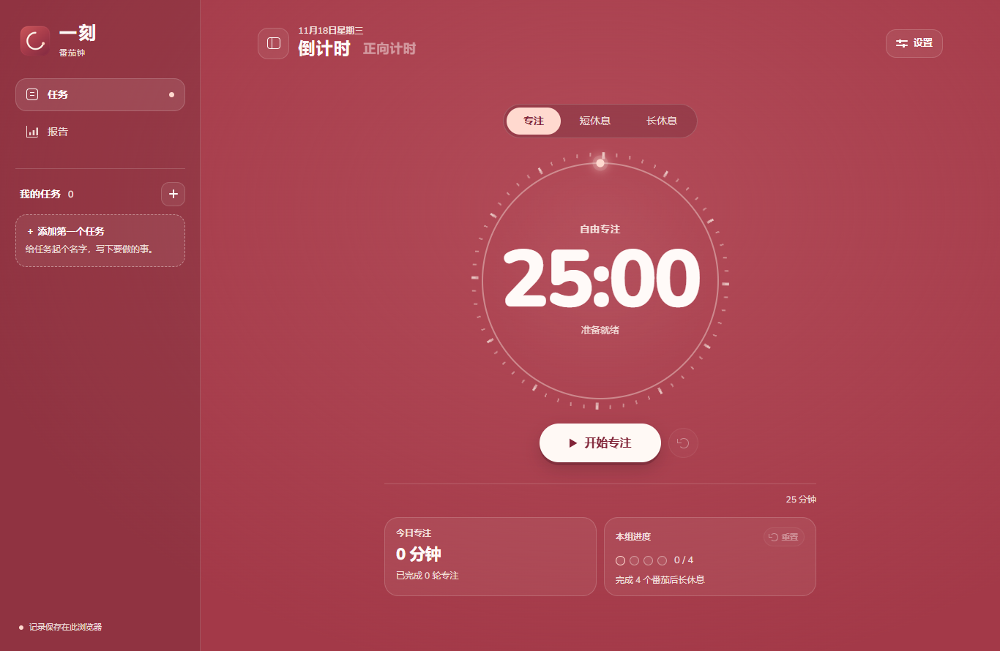

# 一刻 · Yike Focus

无广告、可离线使用的番茄钟，带正向计时、任务备注和专注报告。

An offline, ad-free Pomodoro timer with count-up sessions, task notes, and focus reports.

[下载安装包 · Download](https://github.com/woshibiantai06/yike-focus/releases) · [报告问题 · Report an issue](https://github.com/woshibiantai06/yike-focus/issues)



[English desktop screenshot](assets/desktop-en.png) · [Android screenshot](assets/android-en.png) · [Break alarm screenshot](assets/break-alarm.png)

## 开始使用

| 设备 | 下载后怎么打开 |
| --- | --- |
| 电脑 | 下载 `Yike-Focus-Desktop.html`，保存到固定位置，用 Chrome 或 Edge 打开。之后继续用同一个浏览器和文件路径。 |
| 安卓 8.0 及以上 | 下载 `Yike-Focus-Android.apk`，从系统文件管理器打开。系统询问安装来源时，可只给这次使用的文件管理器授权，安装后可关闭授权。 |

- 在**设置 → 语言 / Language**中切换简体中文和英文。
- 专注默认 25 分钟、短休息 5 分钟，四轮后长休息 15 分钟。正向计时手动完成，休息默认 10 分钟。
- 点倒计时或休息的数字可修改总时长，已计时间保留。计时中可切换任务，整轮时长计入完成或提前结束时选中的任务。
- 在设置中选择倒计时结束提示。轻提示可接着正向计时或自动开始休息。持续响铃时，在闹钟上选择继续专注或开始休息。延长的专注与原倒计时合计为一条记录。
- 报告可在柱状图、任务圆环和专注日历间切换。宽屏圆环用引线标出任务和时长，窄屏在圆环下方显示标注。点日历日期可查看当天记录。报告配色有夜紫、暖白和薄荷。
- 点计时页上的任务名可以快速换任务。结束后可以核对这一轮的任务与时长，也可以补记、纠正任务。点圆环扇区或标注可以筛选专注记录。
- 在「我的任务」点文件夹图标创建分类。文件夹左侧箭头可折叠，右侧加号可在里面建任务。拖动六点把手可以排序，或把任务拖进和拖出文件夹。
- 两种计时和休息都支持轻点暂停、长按结束。正向专注可以切到休息，休息后可以继续同一轮。安卓版允许通知后，计时和任务名会显示在通知栏，可以在通知里暂停和继续。「设置 → 在其他应用上显示悬浮计时」可以开启可拖动的计时窗。持续闹钟最多响铃、振动 3 分钟。
- 任务、设置和历史存储在使用它的浏览器或手机里。卸载安卓 App 或清除浏览器数据会丢失本地记录。电脑和手机各自保存。
- 这是公开测试版。锁屏和后台提示音受系统限制。旧的个人预览包和公开包可同时安装，且分别保存记录。

## Getting started

| Device | Open the release download |
| --- | --- |
| Desktop | Save `Yike-Focus-Desktop.html` to a permanent folder and open it in Chrome or Edge. Keep using the same browser and file path. |
| Android 8.0 and later | Open `Yike-Focus-Android.apk` in your file manager. If Android asks for permission to install from that source, you can grant it to the file manager and turn it off again after installation. |

- Switch between Simplified Chinese and English in **Settings → 语言 / Language**.
- Countdown mode defaults to 25 minutes of focus, a 5-minute break, and a 15-minute break after every four sessions. Count-up sessions end manually and have a 10-minute break by default.
- Tap a countdown or break timer to change its total duration and keep the time already elapsed. You can switch tasks during a session. The task selected when the session ends gets the full session time.
- Choose a focus countdown alert in Settings. A soft chime can keep counting up or start a break automatically. A ringing alarm lets you choose what happens next. Overtime and the planned focus time are logged together.
- Switch between bars, a task donut, and a focus calendar in Reports. On wide screens, leader lines connect donut slices to task names and durations. On narrow screens, labels appear below the donut. Tap a calendar date to see its sessions. Choose from three report themes.
- Tap the current task to switch tasks, check the task and duration after each session, or correct its task in the history. Tap a donut slice or label to filter the history.
- Use the folder icon in My tasks to create a folder. Collapse it with the arrow or add a task with its plus button. Drag the dotted handles to reorder folders and tasks, or to move a task into or out of a folder.
- Tasks, settings, and history are stored in the current browser or on the phone. Uninstalling the Android app or clearing browser data removes local records. Desktop and Android store records separately.
- Tap to pause or hold to end a focus session or break. Pausing reveals Resume and End. Early finishes log the time spent. Use Add task on the timer or in Reports to tag a session afterward.
- In count-up mode you can take a break and resume the same focus session afterward. On Android, allow notifications to see the timer and task name and pause or resume from the notification shade. Enable the draggable floating timer in Settings. Ringing alarms sound and vibrate for up to three minutes.
- This is a public beta. Lock-screen and background alerts depend on device settings. The previous personal preview and public beta can be installed side by side and have separate data.

## 开发 · Build from source

Open `index.html` directly to develop the timer. The build embeds the launch video in the HTML and uses the same self-contained page for Android and desktop.

在 Windows 上构建 Android 包需要 PowerShell、JDK 17 或更高版本、Android SDK Platform 34 和 Build Tools 36.1.0。设置 `JAVA_HOME`，或向脚本传入 `-Jdk`。若 SDK 不在默认位置，可传入 `-Sdk`。

To build on Windows, install PowerShell, JDK 17 or later, Android SDK Platform 34, and Build Tools 36.1.0. Set `JAVA_HOME` or pass `-Jdk`. Pass `-Sdk` for a custom SDK location. Set `YIKE_SIGNING_STORE` and `YIKE_SIGNING_PASSWORD` for your own PKCS#12 keystore with the alias `yike-release`, then run:

```powershell
./android/build-apk.ps1
```

The APK and desktop HTML are written to `release/`. Attach both artifacts to the same GitHub Release so desktop and Android users get the same interface and version. Builds signed with a different key require a separate installation from the official package. For a public fork, choose your own app ID.

## 许可 · License

MIT. The embedded Nunito font is licensed under the SIL Open Font License 1.1. Its full license and copyright notice are included in `index.html`.
